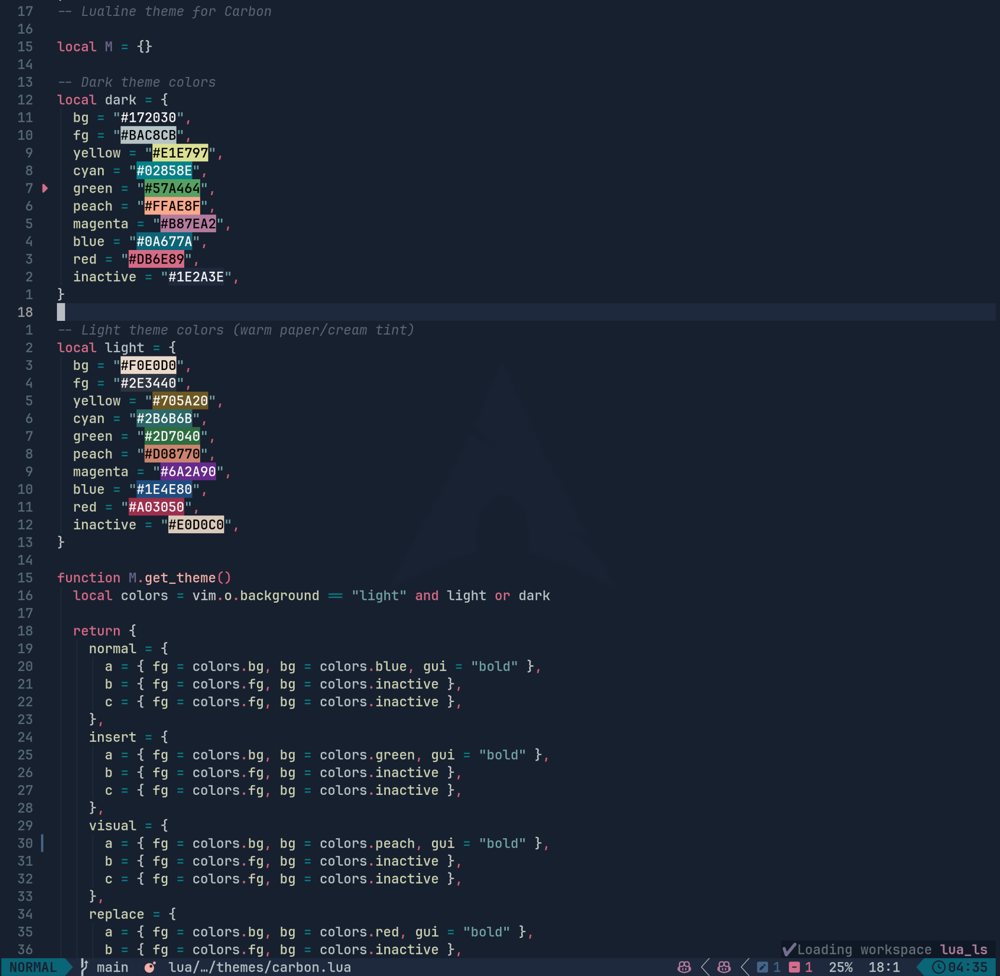
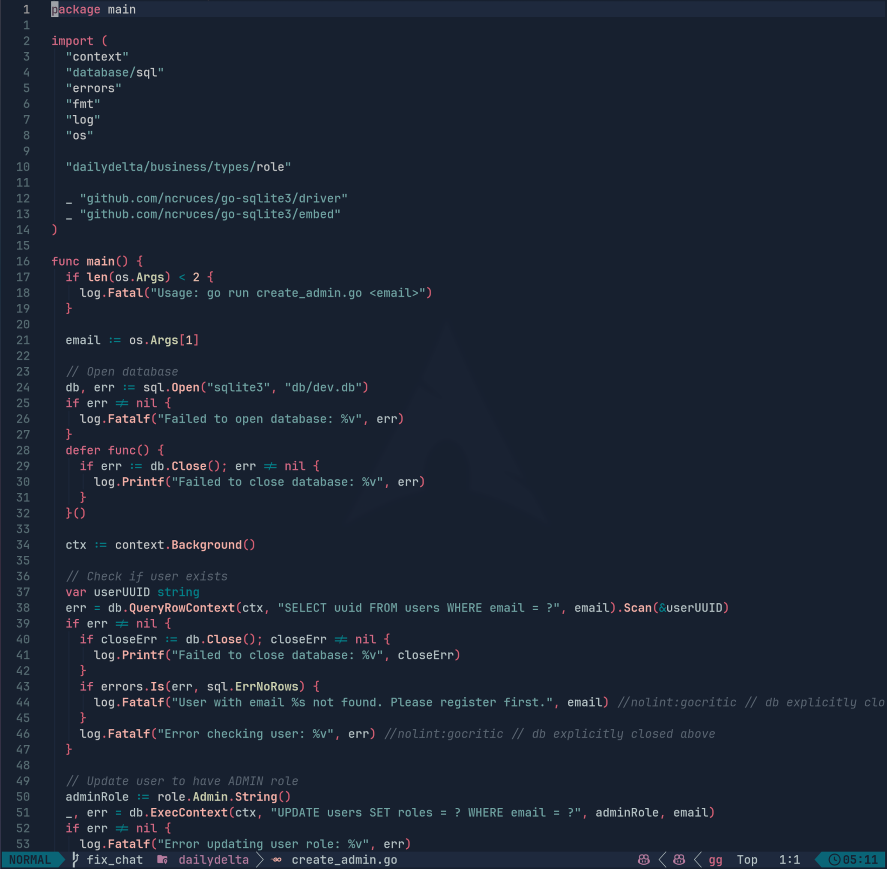
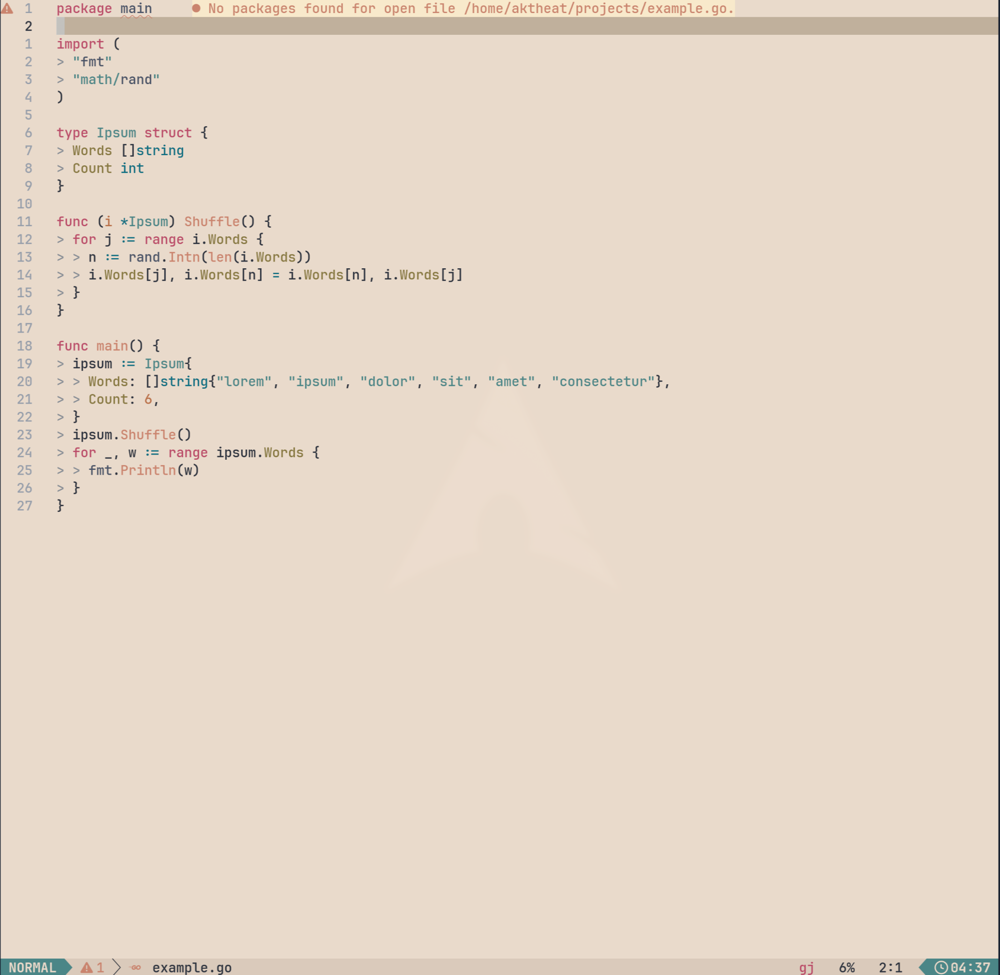
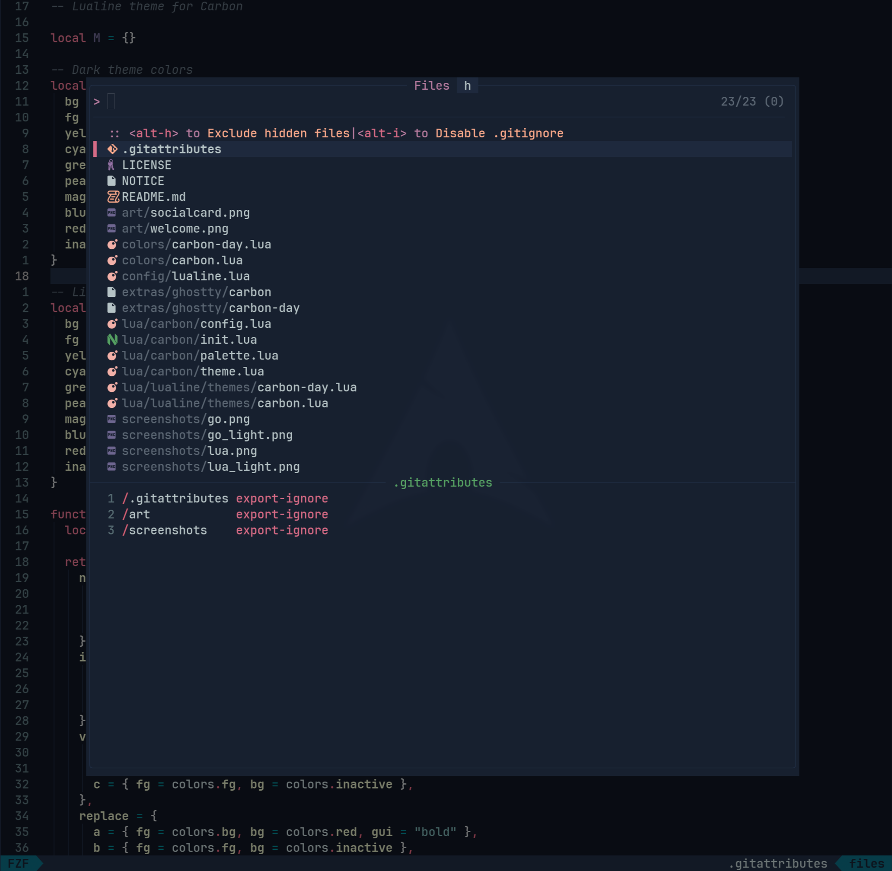
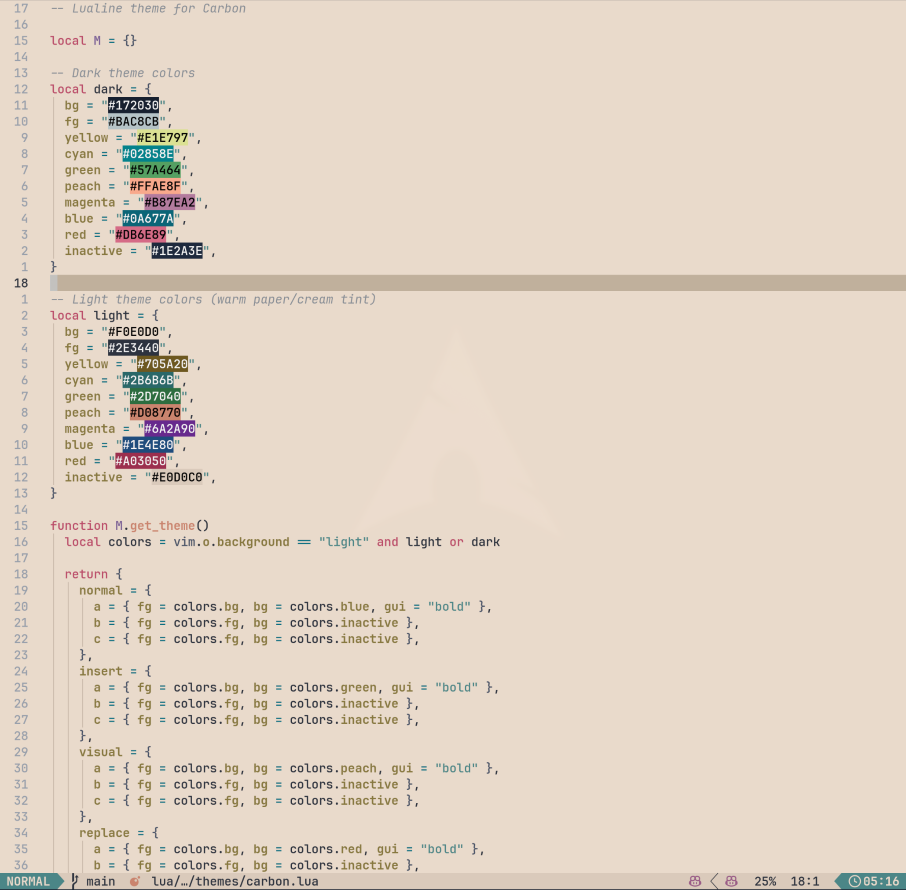
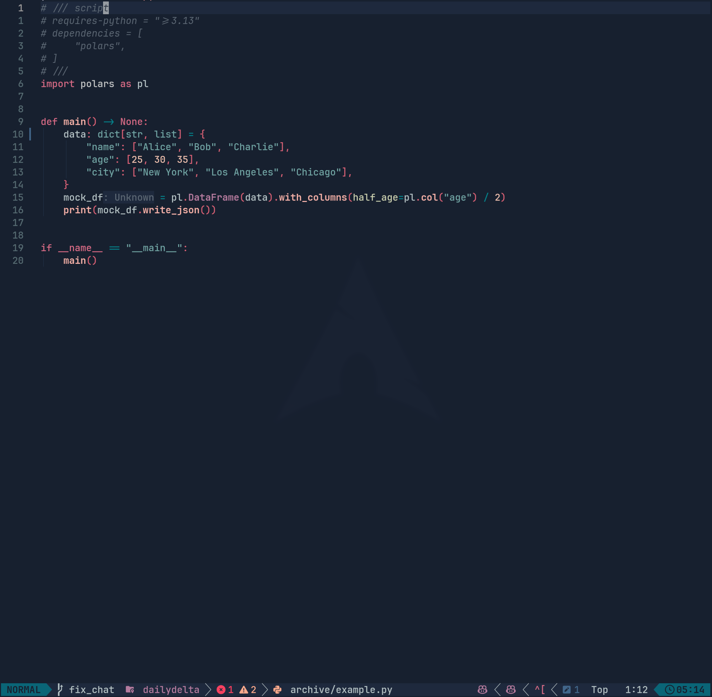
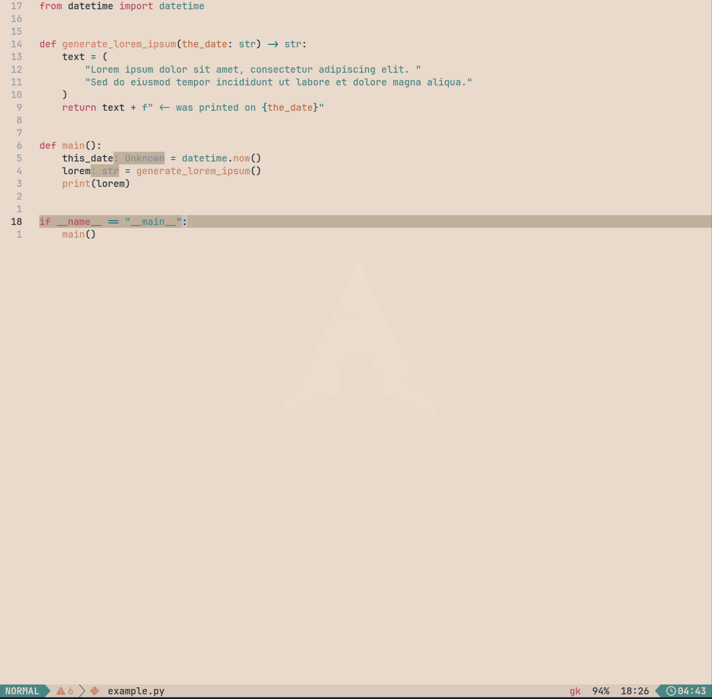

# Carbon.nvim

<p align="center">
  
</p>

A modern Lua-based Neovim colorscheme based on the [Carbon](https://plugins.jetbrains.com/plugin/12280-carbon) theme for IntelliJ IDEs by [Luis Fernando Jiménez](https://github.com/luisfer0793).

This is a rewrite of [michaeldyrynda/carbon.vim](https://github.com/michaeldyrynda/carbon.vim) with full Lua implementation, Treesitter support, and extensive plugin integrations.

## Features

- Modern Lua-based implementation for Neovim
- **Dark and Light variants** (carbon, carbon-day)
- Treesitter support
- LSP semantic highlighting
- Plugin integrations (Telescope, NvimTree, Neo-tree, WhichKey, Cmp, and more)
- Lualine theme included
- Ghostty terminal theme included
- Customizable colors and highlight groups
- Terminal colors support

## Palette design

Carbon retains its IntelliJ-inspired blue dark background, teal strings, pink
keywords, and peach functions. Light variants darken those accents for their
paper backgrounds rather than reusing dark-theme RGB values.

- Body text leads; comments and ordinary punctuation sit below it in emphasis.
- Errors use a distinct red, warnings use ochre, and information uses cool blue/teal.
  Warning colors are separate from peach function and tag colors.
- Operators and ordinary delimiters share a muted foreground across legacy
  syntax, Treesitter, and LSP tokens. Keyword operators and markup keep their
  structural emphasis.
- Search uses the yellow accent, distinct from selection; the current match adds
  bold and underline. Selection sets a readable foreground. Virtual diagnostics
  use the main background to avoid tint-induced contrast loss.
- Borders sit below body text in contrast. Cursor lines and popups use nearby
  surface tones; selections and diffs retain their own emphasis.
- Error, warning, and function foregrounds meet 4.5:1 against the main background,
  cursor line, and popup in all five bundled palettes. This is a targeted design
  constraint, not an accessibility claim for every highlight or custom palette.

[Cendre's measured hierarchy](https://cendretheme.com/) and its
[source and tests](https://github.com/Aejkatappaja/cendre) inspired these refinements; Carbon keeps its own
palette and supports both dark and light backgrounds. Color roles should remain
recognizable without bold or italic. Transparency and custom colors change the
contrast relationships, so the bundled measurements apply to opaque defaults.

Run the applied-highlight and palette checks with:

```sh
nvim --headless -u NONE -l test/highlights.lua
```

### Preview and generated terminal themes

Open a disposable preview buffer with syntax, diagnostics, diff lines, search,
selection instructions, and a completion example:

```sh
nvim -u NONE -c 'set rtp+=.' -c 'luafile scripts/preview.lua'
```

Use `:colorscheme carbon-day`, `carbon-contrast`, `carbon-day-neutral`, or
`carbon-day-contrast` to compare variants. The fixture does not modify files.

Regenerate all five Ghostty themes after palette edits, or check for drift:

```sh
nvim --headless -u NONE -l scripts/ghostty.lua
nvim --headless -u NONE -l scripts/ghostty.lua --check
```

The generator uses the same ANSI mapping as Neovim's terminal. Generated files
contain bundled defaults; custom `on_colors` changes are local to Neovim.

The contrast audit also checks links, hints, constants, inactive text, git colors,
strings, numbers, and parameters at 4.5:1 on main, cursor-line, and popup surfaces;
comments use a quieter 3:1 floor. Selected completion details use the selected
foreground for readability.

Carbon leaves lualine configuration to you. Use lualine's `theme = "auto"` for
colorscheme switching, or an explicit Carbon theme. Carbon no longer changes
lualine options or enforces a background when entering windows. `carbon-auto`
resolves the variant from `background` when loaded.

## Regular Vim

Standalone Vimscript themes are in `extras/vim/`; they need no Lua or Neovim.
Copy the variants you want into Vim's colors directory:

```sh
mkdir -p ~/.vim/colors
cp extras/vim/carbon*.vim ~/.vim/colors/
```

Then select one in `.vimrc` with `colorscheme carbon`, `carbon-day`,
`carbon-contrast`, `carbon-day-neutral`, or `carbon-day-contrast`. These files
contain the shared palette's core syntax, editor, search, diff, and diagnostic
highlights. They are generated from `lua/carbon/palette.lua`; regenerate them
with `nvim --headless -u NONE -l scripts/vim-colors.lua` when the palette changes.
The standalone files themselves run in regular Vim without Neovim.

## Requirements

- Neovim >= 0.8.0
- `termguicolors` enabled

## Installation

### Using lazy.nvim (recommended)

```lua
{
  "akthe-at/carbon.nvim",
  lazy = false,
  priority = 1000,
  config = function()
    require("carbon").setup({
      -- your configuration comes here
      -- or leave it empty to use the default settings
    })
    vim.cmd.colorscheme("carbon")
  end,
}
```

### Using packer.nvim

```lua
use({
	"akthe-at/carbon.nvim",
	config = function()
		require("carbon").setup()
		vim.cmd.colorscheme("carbon")
	end,
})
```

### Using vim-plug

```vim
Plug 'akthe-at/carbon.nvim'
```

Then add to your config:

```lua
require("carbon").setup()
vim.cmd.colorscheme("carbon")
```

### Manual Installation

Clone the repository and add to your runtime path:

```bash
git clone https://github.com/akthe-at/carbon.nvim ~/.local/share/nvim/site/pack/plugins/start/carbon.nvim
```

## Configuration

Carbon comes with sensible defaults, but you can customize it:

```lua
require("carbon").setup({
	style = "carbon", -- "auto", "carbon", "carbon_contrast", "carbon_day", "carbon_day_neutral", "carbon_day_contrast"
	dark_variant = "carbon", -- Used when style = "auto"
	light_variant = "carbon_day", -- Used when style = "auto"
	transparent = false, -- Enable transparent background
	terminal_colors = true, -- Enable terminal colors
	dim_inactive = false, -- Dim inactive windows

	styles = {
		comments = { italic = true },
		keywords = {},
		functions = { bold = true },
		variables = {},
		properties = { bold = true },
	},

	groups = {
		border = "border",
		panel = "cursor_line_bg",
		link = "link",
		error = "error",
		warning = "warning",
		info = "info",
		hint = "hint",
		ok = "git_add",
		todo = "html_tag",
	},

	-- Override colors
	on_colors = function(colors)
		colors.bg = "#1a1a1a"
	end,

	-- Override highlight groups
	on_highlights = function(highlights, colors)
		highlights.Keyword = { fg = colors.keyword, italic = true }
	end,

	-- Customize highlights before they are applied
	before_highlight = function(group, highlight, colors)
		-- highlight.undercurl = false
	end,
})

vim.cmd.colorscheme("carbon")
```

## Theme Variants

Carbon includes dark, light, and contrast variants:

- `carbon` (default dark)
- `carbon_contrast` (high contrast dark)
- `carbon_day` (light)
- `carbon_day_neutral` (cool neutral light)
- `carbon_day_contrast` (high contrast light)

The active `colors_name` matches the chosen style (e.g. `carbon-contrast`, `carbon-day-neutral`), so other plugins can detect the exact variant.

Use `style = "auto"` to follow `vim.o.background`, or set a specific style:

```lua
require("carbon").setup({
	style = "carbon_day",
})
vim.cmd.colorscheme("carbon")
```

Light variants also work with:

```lua
vim.cmd.colorscheme("carbon-day")
vim.cmd.colorscheme("carbon-day-neutral")
vim.cmd.colorscheme("carbon-day-contrast")
```

Dark variants can also be loaded via:

```lua
vim.cmd.colorscheme("carbon-contrast")
```

## Lualine Integration

Carbon includes a lualine theme that matches the colorscheme:

```lua
require("lualine").setup({
	options = {
		theme = "carbon",
	},
})
```

## Ghostty Terminal Theme

Carbon includes theme files for the [Ghostty](https://ghostty.org/) terminal emulator.

### Installation

Copy the theme file to your Ghostty config directory:

```bash
# For dark theme
cp ~/.local/share/nvim/lazy/carbon.nvim/extras/ghostty/carbon ~/.config/ghostty/themes/

# For light theme
cp ~/.local/share/nvim/lazy/carbon.nvim/extras/ghostty/carbon-day ~/.config/ghostty/themes/
```

Then add to your Ghostty config (`~/.config/ghostty/config`):

```
theme = carbon
# or
theme = carbon-day
```

## Plugin Support

Carbon includes highlight groups for popular plugins:

- [Treesitter](https://github.com/nvim-treesitter/nvim-treesitter)
- [LSP Diagnostics](https://neovim.io/doc/user/lsp.html)
- [blink.cmp](https://github.com/Saghen/blink.cmp)
- [nvim-cmp](https://github.com/hrsh7th/nvim-cmp)
- [Telescope](https://github.com/nvim-telescope/telescope.nvim)
- [fzf-lua](https://github.com/ibhagwan/fzf-lua)
- [Snacks.nvim](https://github.com/folke/snacks.nvim)
- [Neogit](https://github.com/NeogitOrg/neogit)
- [Gitsigns](https://github.com/lewis6991/gitsigns.nvim)
- [NvimTree](https://github.com/nvim-tree/nvim-tree.lua)
- [Neo-tree](https://github.com/nvim-neo-tree/neo-tree.nvim)
- [WhichKey](https://github.com/folke/which-key.nvim)
- [Indent Blankline](https://github.com/lukas-reineke/indent-blankline.nvim)
- [Bufferline](https://github.com/akinsho/bufferline.nvim)
- [Lualine](https://github.com/nvim-lualine/lualine.nvim)
- [Lazy.nvim](https://github.com/folke/lazy.nvim)
- [Mason](https://github.com/williamboman/mason.nvim)
- [Trouble](https://github.com/folke/trouble.nvim)
- [Flash](https://github.com/folke/flash.nvim)
- [Mini.nvim](https://github.com/echasnovski/mini.nvim)
- And more...

## Screenshots

<p align="center">
  
  <span>Go</span>
</p>

<p align="center">
  
  <span>Go - Light Variant</span>
</p>

<p align="center">
  
  <span>Lua w/ a floating window</span>
</p>

<p align="center">
  
  <span>Lua - Light Variant</span>
</p>

<p align="center">
  
  <span>Python</span>
</p>

<p align="center">
  
  <span>Python - Light Variant</span>
</p>

## Credits

- Original [Carbon theme](https://plugins.jetbrains.com/plugin/12280-carbon) by [Luis Fernando Jiménez](https://github.com/luisfer0793)
- Original Vim port by [Michael Dyrynda](https://github.com/michaeldyrynda/carbon.vim)
- Theme structure inspired by [tokyonight.nvim](https://github.com/folke/tokyonight.nvim) by [Folke Lemaitre](https://github.com/folke)

## License

[Apache License 2.0](LICENSE)

See [NOTICE](NOTICE) for attribution details.

### Measured role and surface hierarchy

Types, interfaces, aliases, and constructors share the cool blue `class` role.
Fields and parameters share muted peach; ordinary variables stay neutral across
both dark variants. Documentation comments follow the comment role. Properties
have no bold requirement by default.

Panels and floats have dedicated `panel_bg` and `float_bg` colors. Override
`groups.panel` to give both surfaces a custom shared background. Matching brackets
use body text over `match_bg`. Changed diff text has a readable blue foreground.
The checks cover core syntax on panels, floats, and all three diff backgrounds,
plus matching brackets and type-role consistency. Errors stay at least 0.08 in
Euclidean OKLab distance from the eight core syntax roles; this is a design
constraint, not a color-vision accessibility guarantee.

Regenerate the five-variant comparison with `python scripts/palette-preview.py`
and open `previews/palette.html`. The swatches show opaque defaults; inspect real
language captures with `scripts/preview.lua` and Neovim's `:Inspect` as well.
